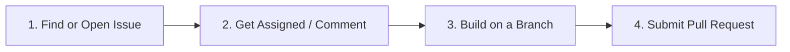

# Contributing to AUI

First off, thank you for your interest in contributing to **AUI**! 🎉 
AUI is an open-source project and community Discord hangout website. We welcome contributions from developers of all skill levels.

---

## 🛠️ Contribution Workflow

We follow a clear, friendly 4-step workflow to keep development organized and prevent duplicate work:



### 1. Find or Open an Issue
- Check existing [GitHub Issues](https://github.com/kishore341507/aui/issues) to see if someone is already discussing or working on it.
- If you find a bug or have a feature idea, [open a new issue](https://github.com/kishore341507/aui/issues/new/choose).
- Please use our **Issue Forms**:
  - Fill in the **Description**
  - Provide clear **Expectation & Acceptance Criteria** (what defines when the issue is solved)
  - Include steps to reproduce (for bugs)

### 2. Claim an Issue
- Before starting code, drop a comment on the issue saying *"I'd like to work on this!"*.
- This helps maintainers assign the issue to you and prevents multiple people working on the same thing simultaneously.

### 3. Development Setup
1. **Fork and clone** the repository:
   ```bash
   git clone https://github.com/<your-username>/aui.git
   cd aui
   ```
2. **Install dependencies**:
   ```bash
   npm install
   ```
3. **Set up `.env`**:
   Follow the [README](README.md#environment-variables) to create your local `.env` file.
4. **Create a descriptive feature branch**:
   ```bash
   git checkout -b feat/your-feature-name
   # or
   git checkout -b fix/your-bugfix-name
   ```
5. **Run the local dev server**:
   ```bash
   npm run dev
   ```

### 4. Submitting a Pull Request (PR)
- When your changes are ready, open a PR against the `master` branch.
- Fill out the **Pull Request Template**:
  - Reference your issue using `Closes #<issue_number>`
  - Verify that the issue's **Expectation & Acceptance Criteria** are fulfilled
  - Ensure the app builds and linter passes:
    ```bash
    npm run lint
    ```
  - Double check that no personal secrets or `.env` files are committed.

---

## 💡 Questions or Need Help?
If you have any questions or just want to chat with the team, come say hello in our **[Discord Server](https://discord.gg/amongusindians)**!

Happy coding! 🚀
